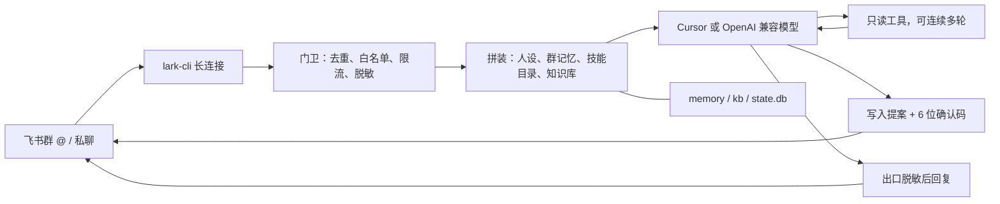

# 飞书群机器人模板

这是一个跑在你自己电脑上的飞书群机器人模板。有人在群里 @ 它，或者私聊它，它就用你这台电脑上的 Cursor（或你自己的 OpenAI 兼容模型账号）来回答。

它能看本群最近的聊天，读分享给它的文档、日历和多维表格，也能看图片和文件。要新建文档、建日程或往表格加记录时，必须由指定的人在限定时间内回复一个 6 位确认码，它才会动手。

每个群可以记自己的事：说「记一下」就记下，说「/记忆」就查看，说「/忘记」就删掉。

仓库里的配置都是占位符。App Secret、填好的群编号和文档编号、客户名名单、聊天记忆和知识库原文都不应该提交。

## English

A template for a Feishu (Lark) group bot that runs on your own computer. It answers @mentions in `chat_ids`, or—only if that list is empty and `chats.auto_join` is on—in groups that pass the admit gate (default: an allow-listed member sends `/认群`). It also answers allow-listed private chats, using Cursor or any OpenAI-compatible model whose API key stays in an environment variable. It can read recent chat, docs, calendars, and Bitable, and it writes only after a one-time confirmation code. Configuration in this repository uses placeholders. Do not commit App Secrets, filled agent configs, customer-name lists, memory, logs, or real knowledge-base files. Apache-2.0.

## 架构

一条消息从飞书进来，先过门卫，再拼上下文，然后交给模型。模型若要读飞书，走只读工具；若要改飞书，先发确认码。回答出去之前再打一次码。



`--doctor` 不在这条路上。它只在本机做诊断，不发消息。本机还有两份不含问题原文的日志：`logs/events.jsonl` 和 `logs/journal.jsonl`。

完整分层图和设计说明：

- [docs/架构.md](docs/架构.md)
- [docs/arch-now.mmd](docs/arch-now.mmd)（现在实际走的路）
- [docs/arch-full.mmd](docs/arch-full.mmd)（分层设计，含尚未默认打开的整理任务）
- [docs/memory-flow.mmd](docs/memory-flow.mmd)

## 功能

- 只在被 @ 或被允许的私聊里回答，不主动发消息。
- 群默认仍看 `chat_ids`。要改成拉进群再认，把 `chat_ids` 留空并打开 `chats.auto_join`。默认还要白名单成员在群里发「/认群」，避免被陌生人拉进乱群消耗额度。见 [agents/CONFIG.md](agents/CONFIG.md)。
- 同一个话题接着聊；发「新话题」就清空这几轮上下文。
- 长期记忆按群分开。白名单里的人才能记和删，删除是真删。
- 进度卡片：先告诉你正在处理（默认关着，配置里打开）。
- 客户名按你的名单打成「某客户」。手机号、证件号、邮箱、密钥样子的字符串和电脑路径自动隐藏。
- 话题红线默认不设。要限制什么，写在自己的配置里。
- 同一个应用只跑一个进程。看门狗发现卡住会在本机重启，不往群里说话。
- 知识库可以定时收进来，先放待审区，你确认后才换上。
- 技能默认关着。打开后，提示词里只放一行目录，命中触发词才放入步骤。见 [docs/技能.md](docs/技能.md)。
- 常驻模式默认关着。`agent.mode` 写成 `acp` 后，Cursor 只启动一次。见 [docs/常驻模式.md](docs/常驻模式.md)。
- 模型可以换成你自己的账号：`model_provider` 写成 `openai_compat`，密钥放在环境变量。见 [docs/模型接口.md](docs/模型接口.md)。拿去参赛时的字段对照见 [docs/用本框架参赛.md](docs/用本框架参赛.md)。

## 快速开始

新人大约 15 分钟可以在自己电脑上把离线测试和配置检查跑起来，不必先有飞书应用。逐步说明在 [docs/快速开始.md](docs/快速开始.md)。遇到报错先看 [docs/排障.md](docs/排障.md)。

```text
python tests/run_tests.py
python checks/check_config.py agents/example.json
python setup_agent.py --name demo --provider deepseek --dry-run
python agentbot.py agents/example.json --doctor
```

最后一条只做只读诊断，不发消息。没有安装 lark-cli 时，它会列出缺什么。真正连上飞书需要 Windows、Python 3.12 和你自己的应用，步骤在 [docs/新建智能体.md](docs/新建智能体.md)。已经有机器人、想换成这套（文档里的例子叫「小景」）看 [docs/升级已有智能体.md](docs/升级已有智能体.md)。

看 PDF 附件时才需要另外安装 `pypdf`。Word、PPT、文本、代码、zip 和图片用标准库。Excel 在装了 `openpyxl` 时读取。没装这些包也不会影响启动。

## English guide

The purpose, the write lock, and the “do not commit” rule are in the English paragraph at the top. The diagram in [架构](#架构) is the path from a Feishu message to a redacted reply. [docs/arch-now.mmd](docs/arch-now.mmd) is that same path with the model choice. [docs/arch-full.mmd](docs/arch-full.mmd) is the longer design, including jobs that are not on by default.

A 15-minute offline start is in [docs/快速开始.md](docs/快速开始.md). Troubleshooting is in [docs/排障.md](docs/排障.md). `--doctor` only prints a local diagnosis and does not send messages.

Quick start on a machine that will really talk to Feishu:

1. Copy `agents/example.json` to a new filename. That copy is gitignored.
2. Replace every `REPLACE_` value with your own ids. Do not put an App Secret in the file.
3. Copy `redact.example.txt` to `redact.txt`. Leave it empty if you have no customer names to hide.
4. On Windows, from the repository root, run `scripts\start.ps1 -Config agents\<your-file>.json`.

Offline tests do not need Feishu or extra packages:

```text
python tests/run_tests.py
```

The last line prints how many checks passed. Do not commit filled-in `agents/*.json`, `redact.txt`, `.env`, `memory/`, `logs/`, `state/`, `state.db`, or real files under `kb/`.

A screenshot placeholder, with rules for hiding ids, is in [docs/demo/README.md](docs/demo/README.md).

## 配置说明

每一项的意思在 [agents/CONFIG.md](agents/CONFIG.md)。常用的几项：

| 键 | 填什么 |
|---|---|
| `profile` | 你在 lark-cli 里起的名字，不是密钥 |
| `bot_open_id` | 机器人自己的编号 |
| `chat_ids` | 允许回答的群。写了就只用它 |
| `chats.auto_join` | 默认 `false`。`chat_ids` 留空后才生效 |
| `chats.admit` | 自动认群的门槛，默认 `confirm`（要 `/认群`） |
| `write.allowed_users` | 谁可以发起写入和改群记忆 |
| `write.resources` | 允许新建或追加的文件夹、文档、日历、多维表格 |
| `model_provider` | `cursor`（默认）或 `openai_compat` |
| `agent.api_key_env` | 只写环境变量的名字，不写密钥本身 |
| `agent.max_tool_rounds` | 只读工具最多连续几轮。不写是 `4` |
| `agent.stall_sec` | 多久没有新输出算卡住。不写是 `300`，写成 `0` 仍按 300 |
| `tools.message_attachment` | 读当前会话的历史附件。不写时跟着附件开关 |
| `shutdown_wait_sec` | 停机再等多久。不写是 `15` 秒 |
| `link_jump_sec` | 休眠多久后重连。不写是 `20` 秒 |
| `catchup.max_age_sec` | 补答最多回溯多久。不写是 12 小时 |
| `redact_file` | 客户名名单，默认 `redact.txt`，不要提交 |

`REPLACE_` 开头的值必须换成你自己的，留着不能启动。

## 安全说明

写操作要同时满足三道锁：人在白名单里、资源在白名单里、动作属于允许的四类（新建文档、文末追加、建日程、加一条表格记录）。发起人还要在原来的会话里回复确认码。没有删除、没有覆盖全文、没有改权限。

密钥放在你自己的电脑上：飞书 App Secret 只在 `lark-cli config init --app-secret-stdin` 时输入；模型密钥只进环境变量。

不要提交这些文件：填好的 `agents/*.json`、`redact.txt`、`memory/`、`logs/`、`state/`、`state.db`、`kb/` 里的真实资料、`.env`。

细节见 [SECURITY.md](SECURITY.md) 和 [docs/安全红线.md](docs/安全红线.md)。

## 文件

| 文件 | 作用 |
|---|---|
| `agentbot.py` | 主程序：收消息、决定回不回、叫模型、回复 |
| `providers/` | 模型接口。默认 `cursor`；`openai_compat` 接你自己的账号；`fake` 只给测试用 |
| `acp_client.py` | 可选的常驻进程。默认不用 |
| `tools.py` | 动飞书的手：只读，以及要确认码的写入 |
| `guard.py` | 打码和话题红线 |
| `memory.py` | 每个群一份长期记忆 |
| `skills.py` | 技能目录、触发词预放和按需读取；默认关闭 |
| `skills/` | 每个技能一个文件夹，里面一份 `SKILL.md` |
| `kb_sync.py` | 知识库先待审、再替换 |
| `make_bundle.py` | 在资料电脑上把笔记打成压缩包 |
| `agents/example.json` | 配置样子，里面都是占位符 |
| `agents/CONFIG.md` | 每一项怎么填 |
| `redact.example.txt` | 空的客户名名单样子，复制成 `redact.txt` 再用 |
| `doctor.py` | `--doctor`：只读诊断，不发消息 |
| `observe.py` | 本机 `logs/events.jsonl` |
| `lifecycle.py` | 单实例锁和优雅停机 |
| `feishu_link.py` | 长连接，以及休眠后的重连 |
| `setup_agent.py` | 干跑生成配置。不加 `--write` 不写文件 |
| `scripts/` | Windows 上的启动、停止、看门狗、计划任务、`verify_windows.ps1` |
| `tests/run_tests.py` | 离线测试。通过时最后一行打印条数 |
| `docs/快速开始.md` | 新人 15 分钟跑起来 |
| `docs/排障.md` | 常见问题 |
| `docs/release-0.4.0.md` | v0.4.0 发布说明草稿，还没有 GitHub Release |
| `docs/` | 给人看的说明和架构图 |
| `SKILL.md` | 给帮忙操作的 AI 助手看的步骤 |

## 参与贡献

看 [CONTRIBUTING.md](CONTRIBUTING.md)。行为约定见 [CODE_OF_CONDUCT.md](CODE_OF_CONDUCT.md)。

## 许可证

本项目以 Apache-2.0 开源。你可以商用、修改、再分发，需要保留许可证和版权声明。全文见 [LICENSE](LICENSE)，版权信息见 [NOTICE](NOTICE)。

本项目调用的第三方模型和工具（例如 Cursor CLI、各家模型 API、飞书开放平台）各有自己的服务条款。使用者需要自己遵守这些条款，并使用自己的账号。
