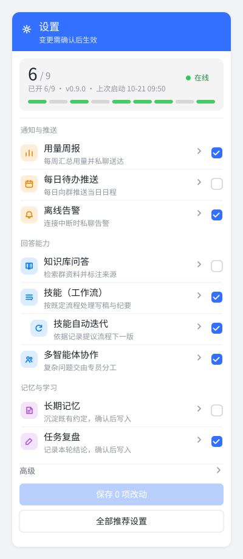

# 在飞书里开关功能

这份说明给不改配置文件的人。主人在和机器人的**私聊**里发「设置」，只收到一张卡片。卡片按「日常」「记忆」「技能」「高级」分组。每一项一行：图标、名字、一句不超过 12 个字的说明、开或关，以及一个勾选。长说明收在折叠的「说明」里。配置里的名字默认收在「配置名字」里，不展开。

不会先发一段「先看这一项」。点勾选后，还是这一张卡片变成确认，不另发一条消息。可以一次勾几项，只确认一次。

群里不能改。同事在群里问「怎么开某某」，机器人只会请他去找主人，不会在群里讲配置。

## 谁能改

能改的人是下面这几类里的任意一种：

- 用量周报要私聊的那个人
- 断线提醒要私聊的那个人
- 配置里已经标成管理员、可以让机器人往飞书写东西的人

其他人私聊发「设置」，只会被告知去找主人。

## 怎么操作

卡片回调已经连上、并且确认方式不是纯确认码时：

1. 打开和机器人的私聊，发「设置」。也可以发「功能开关」。
2. 卡片顶部是概览，例如「已开 6/9 · v0.9.0 · 在线 · 上次启动 10-21 09:50」。版本来自仓库里的 `VERSION`，读不到就不写。正在回答时状态是「在线」。上次启动看的是本机锁文件的时间，没有锁就不写时间。
3. 想改某一项，点这一行右边的开关。卡片当场标成待保存，配置还没写。开是绿色，关是灰色，待保存是橙色。底部主按钮写成「保存 N 项改动」。可以连续点几项，只保存一次。再点已经勾上的那一项，会把它撤下。没有改动时，主按钮是灰的，写着「保存 0 项改动」。
4. 点确认才会备份、写入、检查，然后重新启动。只有你本人、在这同一个私聊里、在有效时间内确认才算数。
5. 点取消，卡片回到清单，什么都不改。
6. 底部次按钮「全部推荐设置」会勾上还没开的「断线提醒」和「用量周报」。已经开着的不动。同样要点「保存」才生效。这两项只私聊你。
7. 点某一行的「详情」，说明就展开在这一行下面：有什么用、打开后会不会主动发消息、要先准备什么。再点「收起」就收回。卡片上没有单独的问号。
8. 早间待办如果在待确认里要打开，卡片上会多一句「早间待办会发到群里。」

确认之后它会自己重新启动，好了再私聊你一声。这中间可能暂时不回消息。

确认方式可以换，不能关掉。在这个私聊里回复「确认方式」就能看现在用的是点按钮还是确认码，并换成另一种。见 [确认方式.md](确认方式.md)。

飞书 7.20 及以上才能画出这张卡片。更早的客户端只能看到标题，并提示升级。

## 卡片没连上时

下面几种情况不发交互卡片，改发一条短文字：卡片回调还没开通、确认方式选的是纯确认码、或者卡片没能发出去。

文字一行一项，例如：

```text
已开 0/9 · v0.9.0 · 在线

日常
1 用量周报  关  每周私聊合计
4 早间待办  关  早上发到群里
5 断线提醒  关  断线时私聊你

回复序号即可，多个用空格，如 1 5。回复 0 是推荐设置（断线提醒和用量周报）。
```

回复 `1` 仍是用量周报。回复 `1 5` 一次改两项，仍要确认一次。回复 `0` 是推荐设置。也可以回复「第 4 项」或「打开知识检索」。点了按钮没反应，也用这个办法。

回复数字时，确认是另外一条消息：点按钮，或回复「确认」加数字。不想改就点「取消」，或回复「取消」加同一串数字。

回复「详细」才看文件名和开关在文件里的名字。平时不用看。

## 示意图

下面三张是示意图，不是真实会话，中文用 Noto Sans CJK SC。完整卡片 JSON 在 [demo/switch-card.example.json](demo/switch-card.example.json) 和 [demo/switch-card-confirm.example.json](demo/switch-card-confirm.example.json)。


刚发出来的清单。浅色状态条写着已开几项。每一组一块浅灰底。一行是标准图标、名字、开或关、浅灰说明和「详情」，右边是开关。底部主按钮停用，次按钮是「全部推荐设置」。


勾了两项之后的同一张卡片。主按钮变成「保存 2 项改动」。点它才写入。点「取消」回到清单。



窄屏仍是一行一项：说明在名字下面换行，开关留在右侧，两个按钮各占一整行。

## 功能开关表

| 功能 | 有什么用 | 打开之后 | 要先准备什么 | 怎么开 |
|---|---|---|---|---|
| 用量周报 | 每周一份用量合计 | 私聊主人，不发到群里，也不写出别人问过的原话 | 不用准备资料。还没指定主人时暂时不会发出去 | 私聊发「设置」 |
| 知识检索 | 回答时引用这个群的资料 | 不主动发消息，有人问才查 | 先把资料放进知识库文件夹，文件夹名字一般是 kb | 私聊发「设置」 |
| 记忆成长 | 提议记住群里定过的事 | 默认私聊审批人。不点头不会记 | 不用先写稿。打开时会把长期记忆一起打开 | 私聊发「设置」 |
| 早间待办 | 早上说今天的日程和未完成任务 | **会发到群里**，每个群每天最多一条 | 日历或任务表要先接上。没指定群就不会发 | 私聊发「设置」 |
| 断线提醒 | 连不上时告诉主人 | 私聊主人，不发到群里 | 不用准备资料。还没指定主人时只会记在本机 | 私聊发「设置」 |
| 技能 | 选题、写稿按现成步骤做 | 不主动发消息 | 技能文件夹里要已经有步骤说明 | 私聊发「设置」 |
| 复盘写回 | 一轮群里的事做完后写一句短复盘 | 点头才记进这个群。默认私聊审批人，不点头不记。私聊对话不写进群记忆 | 不用先写稿。打开时会把长期记忆一起打开。还没指定审批人就不会提议 | 私聊发「设置」 |
| 技能改进 | 根据用过的记录和复盘提议技能下一版 | 先对照固定题目，分数没有更高不换。分数更高还要你确认。确认后才能回滚到上一版 | 技能文件夹里要已有步骤说明。打开时会把技能一起打开 | 私聊发「设置」 |
| 主理人 | 复杂问题拆给查资料、读文档、起草 | 短句还是原来的答法。专员只能读，写入仍要你确认 | 不用先准备。打开时会把工具一起打开 | 私聊发「设置」 |

建议先开「断线提醒」和「用量周报」。这两项只私聊主人。早间待办会在群里发消息，确认之前看清楚再开。

## 第一次用

机器人第一次被主人私聊，或者刚装好、已经写了主人是谁，会主动发一段短介绍：能做什么，以及建议先开哪几项。只发私聊，不发到群里。介绍只发一次。

## 改失败了会怎样

确认之后，机器人会先把现在的配置复制一份备份，再写入，再做一次配置检查。检查没通过，或者重新启动没成功，会自动改回备份，并用大白话告诉你原因和下一步。不会留着一份改坏的配置继续跑。

重新启动和本机的停止、看门狗是同一套：先请当前这个自己退出，确认没有第二个接收进程，再启动一个。已经有一个在跑时，不会再开一个。

## 不能在对话里改的

下面这些只能让懂配置的同事改文件，聊天里说了也不会改：

- 飞书密钥、模型密钥
- 模型接口、换成哪一家模型
- 谁可以私聊机器人，包括「所有人都能私聊」

回复「详细」可以看到文件名和开关在文件里的名字。那里没有密钥。

## 给同事看的补充

程序只改下面这些开关，其它键不动：

| 你看到的名字 | 文件里的名字 |
|---|---|
| 用量周报 | `report.enabled` |
| 知识检索 | `knowledge.enabled` |
| 记忆成长 | `memory.growth.enabled`（打开时同时把 `memory.enabled` 设为开） |
| 早间待办 | `digest.enabled` |
| 断线提醒 | `alerts.enabled` |
| 技能 | `skills.enabled` |
| 复盘写回 | `memory.retrospect.enabled`（打开时同时把 `memory.enabled` 设为开） |
| 技能改进 | `skills.evolve.enabled`（打开时同时把 `skills.enabled` 设为开） |
| 主理人 | `agent.crew.enabled`（打开时同时把 `features.tools` 设为开） |

开关先记在本机 `state/switch_menu.json`，大约 30 分钟。这只是待保存，不改配置。点「保存」才用原来的一次性记号写入。记号默认 10 分钟，只认发起人和原来的私聊。飞书还没准备好时，仍用确认码：位数默认 6，存在本机 `state/switches.db`，绑定发起人和会话，过期时间沿用写入确认那一项（不写是 5 分钟）。用过、取消过的不能再用。

一次确认多项时，只备份一次：先关要关的，再开要开的，检查一次，重启一次。检查或重启失败，整份改回这份备份。日志在 `logs/feature_switch.jsonl`，只有动作和哈希，没有编号、确认码和密钥。

飞书卡片是 JSON 2.0。点开关或「详情」后，程序用更新消息把原来那张卡片换成新的内容。长连接收不到网页回调那种响应体，所以不靠 HTTP 响应来换卡片。对照官方文档时，响应形状是 `card.type = raw`，`data` 就是这张卡片。示例见 [demo/README.md](demo/README.md)。

备份在 `state/config-backups/`。Windows 上由 `scripts/reload.ps1` 调用原来的 `stop.ps1` 再 `start.ps1`。还有本目录的接收进程时，脚本退出码是 3，不会再启动。

## 界面参考

布局参照这几类已经用熟的设置页，组件用飞书卡片 JSON 2.0 里现成的：

- 飞书没有开关组件。一行右边用 [checker](https://open.feishu.cn/document/feishu-cards/card-json-v2-components/interactive-components/checker)。不写 `behaviors` 时，勾选只在手机上变，服务器收不到。这里写了回调。图标用 [图标库](https://open.feishu.cn/document/feishu-cards/enumerations-for-icons) 里的 `standard_icon`，不用 emoji。
- 名字和开关用 [分栏 column_set](https://open.feishu.cn/document/feishu-cards/card-json-v2-components/containers/column-set)，窄屏按比例压缩，不把开关挤到下一行。分组用浅灰底。状态用 [标签](https://open.feishu.cn/document/uAjLw4CM/ukzMukzMukzM/feishu-cards/card-components/content-components/rich-text)：开是绿色，关是灰色，待保存是橙色。说明是浅灰小字。「详情」是写明文字的文字按钮。配置名字仍用 [折叠面板](https://open.feishu.cn/document/feishu-cards/card-json-v2-components/containers/collapsible-panel)。
- 底部主按钮是「保存 N 项改动」，次按钮是「全部推荐设置」，和飞书卡片搭建工具里审批卡片一样：蓝标题、状态标签、主按钮在最下面。没有改动时主按钮停用。
- 不用表单。表单要点提交才把全部值一次交回来，勾选的当时卡片换不过来。见 [卡片 JSON 2.0 组件](https://open.feishu.cn/document/feishu-cards/card-json-v2-components/component-json-v2-overview) 里对 form 的说明。
- 点完之后换掉原来那张卡片，对照 [卡片回传交互](https://open.feishu.cn/document/uAjLw4CM/ukzMukzMukzM/feishu-cards/handle-card-callbacks) 里 `card.type = raw` 的响应。本机器人走长连接，实际用更新消息写回同一份 `data`。
- 分组浅灰块、左侧图标、右侧开关，对照 [iOS 设置](https://developer.apple.com/design/human-interface-guidelines/settings)。名字下面一行浅灰说明，对照 Notion 和 Linear 的设置页。一块主页里改状态、不另开一条消息，对照 [Slack App Home](https://api.slack.com/surfaces/app-home)。点了之后改原来那条，对照 Telegram 的 [editMessageReplyMarkup](https://core.telegram.org/bots/api#editmessagereplymarkup)。
