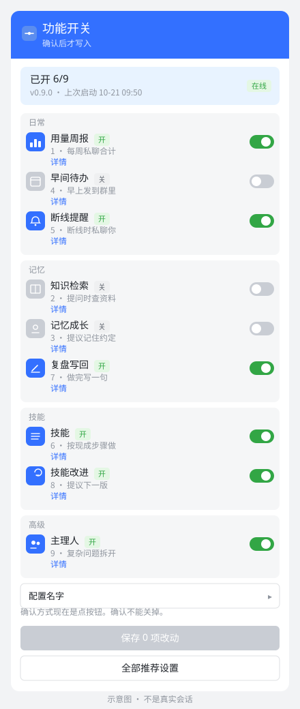
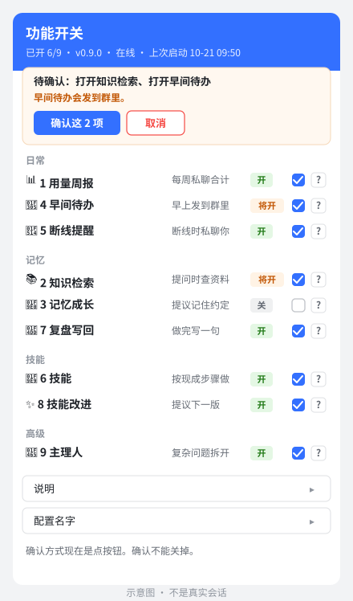

# 在飞书里开关功能

这份说明给不改配置文件的人。主人在和机器人的**私聊**里发「设置」，就会看到一张清单。一次只改一项。

群里不能改。同事在群里问「怎么开某某」，机器人只会请他去找主人，不会在群里讲配置。

## 谁能改

能改的人是下面这几类里的任意一种：

- 用量周报要私聊的那个人
- 断线提醒要私聊的那个人
- 配置里已经标成管理员、可以让机器人往飞书写东西的人

其他人私聊发「设置」，只会被告知去找主人。

## 怎么操作

1. 打开和机器人的私聊，发「设置」。也可以发「功能开关」。
2. 看卡片上的一项。上面写着现在是开还是关、有什么用、打开后会不会主动发消息、要不要先准备资料。
3. 点「第 N 项」，或者直接回复数字，例如 `1`。
4. 看它复述的改动：要改哪一项、现在是开还是关、打开后会怎样。没问题再确认。默认点卡片上的「确认」或「取消」。如果它发给你的是一句「确认」加数字，就回复那一句。不想改就点「取消」，或回复「取消」加同一串数字。
5. 只有你本人、在这同一个私聊里、在有效时间内确认才算数。别人点同一张卡片不算，换一个聊天窗口也不行。
6. 确认之后它会自己重新启动，好了再私聊你一声。这中间可能暂时不回消息。

确认方式可以换，不能关掉。在这个私聊里回复「确认方式」就能看现在用的是点按钮还是确认码，并换成另一种。见 [确认方式.md](确认方式.md)。

点按钮如果没有反应，回复数字就行。

> 截图占位：主人私聊发「设置」之后的清单。不要放真实密钥、手机号、邮箱、群号或人名。

> 截图占位：改动摘要和确认码。确认码每次都不一样，图里用的是示意数字。

## 功能开关表

| 功能 | 有什么用 | 打开之后 | 要先准备什么 | 怎么开 |
|---|---|---|---|---|
| 用量周报 | 每周一份用量合计 | 私聊主人，不发到群里，也不写出别人问过的原话 | 不用准备资料。还没指定主人时暂时不会发出去 | 私聊发「设置」 |
| 知识检索 | 回答时引用这个群的资料 | 不主动发消息，有人问才查 | 先把资料放进知识库文件夹，文件夹名字一般是 kb | 私聊发「设置」 |
| 记忆成长 | 提议记住群里定过的事 | 默认私聊审批人。不点头不会记 | 不用先写稿。打开时会把长期记忆一起打开 | 私聊发「设置」 |
| 早间待办 | 早上说今天的日程和未完成任务 | **会发到群里**，每个群每天最多一条 | 日历或任务表要先接上。没指定群就不会发 | 私聊发「设置」 |
| 断线提醒 | 连不上时告诉主人 | 私聊主人，不发到群里 | 不用准备资料。还没指定主人时只会记在本机 | 私聊发「设置」 |
| 技能 | 选题、写稿按现成步骤做 | 不主动发消息 | 技能文件夹里要已经有步骤说明 | 私聊发「设置」 |

建议先开「断线提醒」和「用量周报」。这两项只私聊主人。早间待办会在群里发消息，确认之前看清楚再开。

## 第一次用

机器人第一次被主人私聊，或者刚装好、已经写了主人是谁，会主动发一段短介绍：能做什么，以及建议先开哪几项。只发私聊，不发到群里。介绍只发一次。

## 改失败了会怎样

确认之后，机器人会先把现在的配置复制一份备份，再写入，再做一次配置检查。检查没通过，或者重新启动没成功，会自动改回备份，并用大白话告诉你原因和下一步。不会留着一份改坏的配置继续跑。

重新启动和本机的停止、看门狗是同一套：先请当前这个自己退出，确认没有第二个接收进程，再启动一个。已经有一个在跑时，不会再开一个。

## 不能在对话里改的

下面这些只能让懂配置的同事改文件，聊天里说了也不会改：

- 飞书密钥、模型密钥
- 模型接口、换成哪一家模型
- 谁可以私聊机器人，包括「所有人都能私聊」

回复「详细」可以看到文件名和开关在文件里的名字。那里没有密钥。

## 给同事看的补充

程序只改下面这些开关，其它键不动：

| 你看到的名字 | 文件里的名字 |
|---|---|
| 用量周报 | `report.enabled` |
| 知识检索 | `knowledge.enabled` |
| 记忆成长 | `memory.growth.enabled`（打开时同时把 `memory.enabled` 设为开） |
| 早间待办 | `digest.enabled` |
| 断线提醒 | `alerts.enabled` |
| 技能 | `skills.enabled` |

确认默认点按钮，10 分钟内有效。飞书还没准备好时，仍用确认码：位数默认 6，存在本机 `state/switches.db`，绑定发起人和会话，过期时间沿用写入确认那一项（不写是 5 分钟）。用过、取消过的不能再用。日志在 `logs/feature_switch.jsonl`，只有动作和哈希，没有编号、确认码和密钥。

备份在 `state/config-backups/`。Windows 上由 `scripts/reload.ps1` 调用原来的 `stop.ps1` 再 `start.ps1`。还有本目录的接收进程时，脚本退出码是 3，不会再启动。
